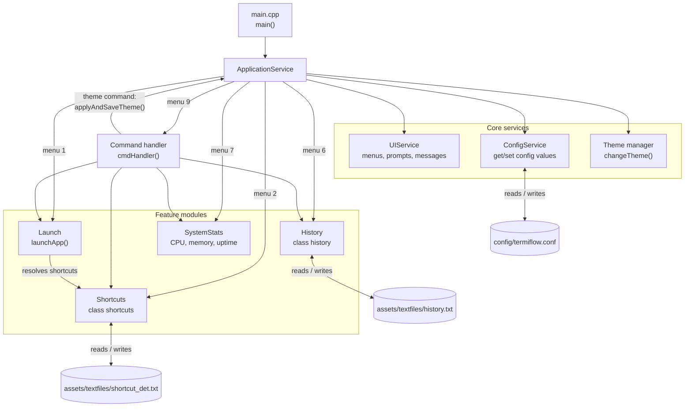
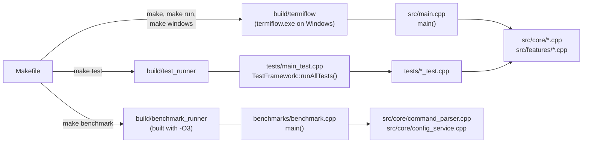
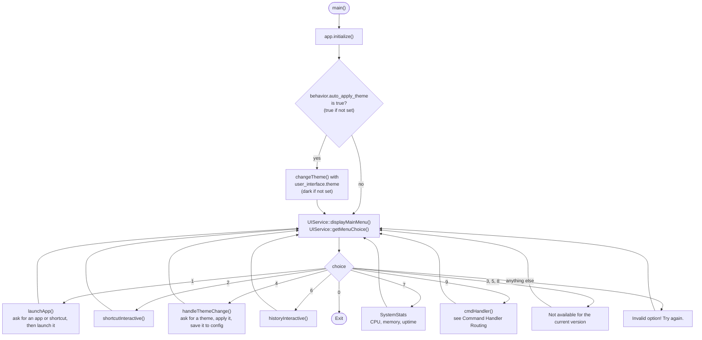
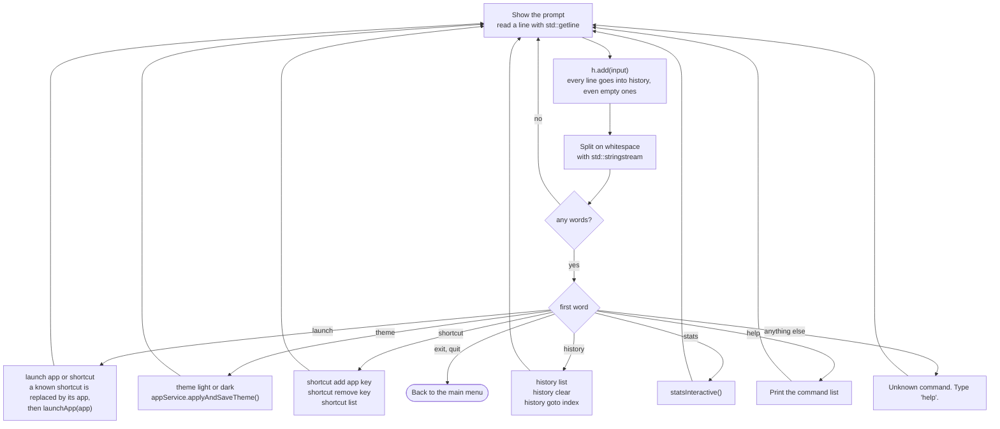

# TermiFlow Architecture Documentation

## Project Overview

>- TermiFlow is a **command-driven terminal application** written in C++ that provides a centralized hub for launching applications, managing shortcuts, tracking command history, and viewing system information.      
>-  It operates as a menu-driven CLI tool with modular component architecture.

**Technology Stack:**

- **Language:** C++ (C++11 and later)
- **Compiler:** g++ or MinGW (for Windows)
- **Platform:** Linux/Windows (cross-platform via conditional compilation)
- **Configuration:** Plain text config file (INI-like format)
 - **Configuration:** Plain text config file (INI-like format). For full details and examples, see [TermiFlow Config Docs](config.md#termiflow-configuration-file-termiflowconf).
- **Data Storage:** File-based (shortcuts, history, config)


## Core Design Philosophy

- **Service-oriented architecture** – clean separation of concerns between business logic, UI, and data layers
- **Dependency injection** – services are initialized and injected into the application layer
- **C++ first** – performance, control, and systems-level understanding  
- **Extensible by design** – new commands can be added without rewriting core logic  
- **Terminal-native** – works where developers already live
- **Testability** – business logic decoupled from UI and I/O operations


## System Architecture

How the parts of the app connect, and which files each part reads or writes. Paths are relative to the directory TermiFlow is run from.



- `ApplicationService` owns a `ConfigService` and a `UIService`. The feature modules are free functions or classes it calls directly.
- `shortcuts` and `history` load their file when the object is created, so each menu option and the command handler work on a fresh copy read from disk.
- The command handler changes the theme through `ApplicationService::applyAndSaveTheme()`, so the new theme is saved to the config file the same way as menu option 4.

## Code Entry Points

The Makefile builds three programs. Each has its own `main()` and compiles a different set of sources.



| Program | Entry point | Also compiles |
|---|---|---|
| `build/termiflow` | `src/main.cpp` | every file in `src/core/` and `src/features/` |
| `build/test_runner` | `tests/main_test.cpp` | every `tests/*_test.cpp`, plus all of `src/core/` and `src/features/` (not `src/main.cpp`) |
| `build/benchmark_runner` | `benchmarks/benchmark.cpp` | only `command_parser.cpp` and `config_service.cpp` |

> [!NOTE]
> `tokenizeCommand()` in `command_parser.cpp` is used by the tests and the benchmark. The command handler in the app splits input with its own `std::stringstream` loop and does not call it.


## Component Architecture

### Architecture Layers

TermiFlow follows a **three-layer service-oriented architecture**:

### 1. Entry Point: main.cpp

- **Responsibility:** Application bootstrap and error handling

- **Key Structure:**
    - Creates `ApplicationService` instance (dependency container)
    - Calls `app.initialize()` to set up configuration and theme
    - Calls `app.run()` to start the main application loop
    - Minimal code, delegates all logic to ApplicationService

- **Current Flow:**
    ```txt
    Application Start
        ↓
    Create ApplicationService
        ↓
    Initialize (load config, apply theme)
        ↓
    Run main loop (orchestrated by ApplicationService)
        ↓
    Exception handling and cleanup
    ```

### 2. Core Services (Service Layer)

#### A. ApplicationService (application_service.hpp/cpp)

- **Purpose:** Core business logic orchestration and application control flow

- **Responsibilities:**
    - Initialize application (load configuration, apply theme)
    - Orchestrate main event loop
    - Delegate feature requests to appropriate modules
    - Handle theme changes and configuration updates
    - Manage application state

- **Key Methods:**
    - `initialize()` - Load config and apply auto-theme if enabled
    - `run()` - Main application loop with menu dispatch via switch statement
    - `shouldApplyAutoTheme()` - Check auto-theme setting
    - `getCurrentTheme()` - Get current theme preference
    - `handleThemeChange()` - Coordinate theme change between services

- **Dependencies:**
    - `ConfigService` - For configuration management
    - `UIService` - For user interaction
    - Feature modules (Launch, Shortcuts, History, etc.)

    **Architecture Pattern:** Dependency injection and facade pattern

#### B. UIService (ui_service.hpp/cpp)

- **Purpose:** Centralize all user interface and presentation logic

- **Responsibilities:**
    - Display menus and prompts to user
    - Collect and validate user input
    - Format and display messages, errors, and success notifications
    - Isolate all I/O operations from business logic

- **Key Methods:**
    - `displayMainMenu()` - Show main menu
    - `getMenuChoice()` - Get and validate menu selection (0-9)
    - `getThemeInput()` - Prompt for theme selection
    - `displayMessage(message)` - Display generic message
    - `displayError(error)` - Display error message
    - `displaySuccess(message)` - Display success message
    - `getUserInput(prompt)` - Get generic user input

- **Key Features:**
    - Input validation (ensures numeric choices are digits 0-9)
    - Consistent message formatting
    - Centralized output - all presentation goes through this service
    - Enables easy testing (can be mocked or replaced)

#### C. ConfigService (config_service.hpp/cpp)

- **Purpose:** Manage all configuration file I/O and data access

- **Responsibilities:**
    - Load configuration from `config/termiflow.conf`
    - Parse INI-like config file format
    - Store configuration in memory (unordered_map)
    - Save configuration changes to file
    - Provide get/set interface for config values

- **Key Methods:**
    - `loadConfig()` - Read and parse config file
    - `saveConfig()` - Write configuration back to file
    - `getValue(key, defaultValue)` - Retrieve config value
    - `setValue(key, value)` - Update config value
    - `getConfig()` - Get entire configuration object

- **Data Structure:**
    ```cpp
    struct Config {
        std::unordered_map<std::string, std::string> values;
    };
    ```

- **Config Keys:**
    - `user_interface.theme` - Current theme (light/dark)
    - `user_interface.show_banner` - Show banner on startup
    - `behavior.auto_apply_theme` - Auto-apply theme on startup

- **File Format:**
    ```ini
    [user_interface]
    theme=dark
    show_banner=true

    [behavior]
    auto_apply_theme=true
    ```
> For more details, check [TermiFlow Config Docs](config.md#termiflow-configuration-file-termiflowconf)

### 3. Feature Modules

#### A. Theme Manager (theme_manager.hpp/cpp)

- **Purpose:** Apply and manage terminal color themes

- **Key Functions:**
    - `changeTheme(std::string theme)` - Apply named theme to terminal
    - `changeTheme()` - Interactive theme selection (deprecated, use UIService)

- **Supported Themes:** Light, Dark (platform-dependent ANSI codes)

- **Implementation:** Uses ANSI escape sequences for terminal color control

> [!NOTE]      
> In the new SOC architecture:     
> - Theme application logic is isolated in this module
> - Theme persistence is handled by `ConfigService`
> - Theme UI interaction is delegated to `UIService`
> - ApplicationService coordinates between these services

#### B. Launcher (launch.hpp/cpp)

- **Purpose:** Execute/launch system applications

- **Key Functions:**
    - `launchApp()` - Interactive app selection and launching
    - `launchApp(std::string appName)` - Direct app launch by name

- **Functionality:**
    - Presents list of available applications to user
    - User selects application to launch
    - Executes application via system/platform-specific calls

- **Platform Support:**
    - Linux: Uses `execvp()` or similar system call
    - Windows: Uses `CreateProcess()` or `system()` call

- **Integration:** Called by `ApplicationService` on menu option '1'

#### C. Shortcuts (shortcuts.hpp/cpp)

- **Purpose:** Define and manage custom command shortcuts

- **Architecture:** Class-based with in-memory state management

    ```cpp
    class shortcuts {
        // Storage
        std::unordered_map<std::string, std::string> shortMap;
        std::string filepath;
        
        // Methods
        void add(const std::string& key, const std::string& value);
        void remove(const std::string& key);
        void save();
        void list();
        void load();
        bool exists(const std::string& value);
        std::string getValue(const std::string& key);
    };
    ```

- **Key Features:**
    - In-memory HashMap for O(1) lookup
    - File persistence (unknown format)
    - Add/remove/list/search operations
    - Interactive mode (`shortcutInteractive()`)

- **Integration:** Called by `ApplicationService` on menu option '2'

#### D. History (history.hpp/cpp)

- **Purpose:** Track and display command history

- **Architecture:** Class-based with vector storage

    ```cpp
    class history {
        std::string filePath;
        std::vector<std::string> cmdEntries;
        
        void load();
        void save();
        void add(const std::string& cmd);
        void list();
        std::string get(int index);
        void historyClear();
    };
    ```

- **Key Features:**
    - In-memory vector storage (ordered)
    - File persistence
    - Add/list/clear/index operations
    - Interactive mode (`historyInteractive()`)

- **Integration:** Called by `ApplicationService` on menu option '6'

#### E. Session Manager (session_manager.hpp/cpp)

- **Purpose:** Manage sessions and running tasks

- **Status:** Planned for future implementation

- **Integration:** Called by `ApplicationService` on menu option '3'

#### F. System Stats (system_stats.hpp/cpp)

- **Purpose:** Display system information and statistics

- **Status:** Partially implemented

- **Key Functions:**
    - `statsInteractive()` - Display system statistics

- **Integration:** Called by `ApplicationService` on menu option '7'

#### G. Command Handler (command_handler.hpp/cpp)

- **Purpose:** Provide an interactive command-line interface as an alternative to the menu-driven UI

- **Responsibilities:**
    - Parse user command input from standard input
    - Tokenize commands into arguments
    - Route commands to appropriate feature modules
    - Support command shortcuts for quick access
    - Maintain command history
    - Provide help and usage information

- **Key Function:**
    - `cmdHandler()` - Main interactive command loop

- **Supported Commands:**

    1. **launch** - Execute applications
        ```bash
        launch <app>           // Launch app directly
        launch <shortcut>      // Launch app via shortcut
        
        Examples:
        launch chrome          // Launch Chrome directly
        launch c               // Launch Chrome via 'c' shortcut
        ```

    2. **theme** - Change terminal theme
        ```bash
        theme <light|dark>     // Apply theme
        
        Example:
        theme dark             // Apply dark theme
        ```

    3. **shortcut** - Manage command shortcuts
        ```
        shortcut add <app> <key>      // Add shortcut (e.g., shortcut add chrome c)
        shortcut remove <key>          // Remove shortcut (e.g., shortcut remove c)
        shortcut list                  // List all shortcuts
        ```

    4. **history** - Manage command history
        ```bash
        history list                   // Display all commands
        history clear                  // Clear history
        history goto <index>           // Display the command at the given history index
        
        Examples:
        history list                   // Show all commands
        history goto 1                 // Display the first command
        ```

    5. **stats** - Display system statistics
        ```bash
        stats                          // Show system information
        ```

- **Architecture Pattern:**
    - String tokenization via `std::stringstream`
    - Command dispatch via string matching and if-else chain
    - Integration with all core feature modules (Launch, Theme, Shortcuts, History, Stats)

- **Data Flow:**
    ```
    User input (e.g., "launch chrome")
        ↓
    Parse & tokenize via std::stringstream
        ↓
    Extract command token (e.g., "launch")
        ↓
    Match against known commands
        ↓
    Extract arguments (e.g., ["chrome"])
        ↓
    Call appropriate feature function
        ├─ Launch module: launchApp(tokens[1])
        ├─ Theme module: changeTheme(tokens[1])
        ├─ Shortcuts module: s.add/remove/list()
        ├─ History module: h.add/list/goto()
        └─ Stats module: statsInteractive()
        ↓
    Add command to history
        ↓
    Return to command prompt
    ```

- **Error Handling:**
    - Validates argument count for each command
    - Provides usage information on invalid syntax
    - Continues loop on error without crashing
    - Supports exception handling for operations like history index access

- **Integration:** Called by `ApplicationService` on menu option '9'

> [!TIP]       
> The command handler provides a powerful alternative interface for power users and scripting. It complements the menu-driven interface and enables keyboard-driven workflows without navigating menus.

## Data Flow Diagrams

### Main Menu Dispatch

What happens from startup to exit, following `main()`, `ApplicationService::initialize()` and the `switch` in `ApplicationService::run()`.



If an exception escapes a menu option, `run()` shows it with `UIService::displayError()` and the app exits.

### Command Handler Routing

How `cmdHandler()` in `src/core/command_handler.cpp` handles each line typed at the `>>>` prompt.



A command with the wrong arguments prints a usage or error message and goes back to the prompt.

### Application Initialization Flow

```txt
main() starts
    ↓
Create ApplicationService instance
    ├─ Initializes ConfigService (loads config/termiflow.conf)
    ├─ Initializes UIService
    └─ Initializes ThemeManager
    ↓
app.initialize()
    ├─ Load config via ConfigService
    ├─ Check auto_apply_theme setting
    └─ Apply theme if enabled
    ↓
app.run() - Enter main loop
```

### Main Event Loop Flow
```txt
UIService.displayMainMenu()  [UI Layer]
    ↓
UIService.getMenuChoice()  [UI Layer]
    ↓
ApplicationService.run()  [Business Logic Layer]
    ├─ Validate choice (0-9)
    └─ Dispatch via switch statement
    ↓
Feature module (Launch, Shortcuts, History, etc.)
    ├─ Perform business logic
    ├─ Use ConfigService for data access [Data Layer]
    └─ Use UIService for user interaction [UI Layer]
    ↓
Return to menu loop
```

### Theme Change Flow

```txt
User selects "4. Change theme"
    ↓
ApplicationService.handleThemeChange()  [Business Logic]
    ├─ UIService.getThemeInput()  [UI Layer]
    │   └─ Display theme options and collect input
    ├─ ThemeManager.changeTheme(theme)  [Feature Layer]
    │   └─ Apply ANSI codes to terminal
    ├─ ConfigService.setValue("user_interface.theme", theme)  [Data Layer]
    ├─ ConfigService.saveConfig()  [Data Layer]
    │   └─ Write to config/termiflow.conf
    └─ UIService.displaySuccess()  [UI Layer]
    ↓
Return to main menu
```

### Feature Feature Module Execution Pattern

```txt
ApplicationService.run()
    ↓
User selects menu option
    ↓
ApplicationService delegates to feature module
    ├─ Feature performs its business logic
    ├─ Feature may call ConfigService for persistence
    ├─ Feature may call UIService for user interaction
    └─ Feature returns to ApplicationService
    ↓
ApplicationService returns to main loop
```

### Shortcuts Management Flow

```txt
User selects "2. Manage shortcuts"
    ↓
ApplicationService.shortcutInteractive()  [Business Logic]
    ├─ Load shortcuts from file
    ├─ Display options via UIService  [UI Layer]
    ├─ Get user choice via UIService  [UI Layer]
    ├─ If add/remove:
    │   ├─ Update in-memory map
    │   ├─ Save to file via persistence
    │   └─ Display success via UIService  [UI Layer]
    └─ If list:
        └─ Display all shortcuts via UIService  [UI Layer]
    ↓
Return to main menu
```

### Command Handler Flow (Alternative Interface)

```txt
User selects "9. Command Handler" (or accessed directly)
    ↓
cmdHandler() main loop starts
    ↓
Display ">>>" prompt
    ↓
Read user input (e.g., "launch chrome")
    ↓
Tokenize input via std::stringstream
    ↓
Extract command (e.g., "launch")
    ↓
Match command and validate arguments
    ↓
Branch to feature handler:
    ├─ "launch": Call launchApp(tokens[1])
    ├─ "theme": Call changeTheme(tokens[1])
    ├─ "shortcut": Call shortcuts.add/remove/list()
    ├─ "history": Call history.add/list/clear/goto()
    ├─ "stats": Call statsInteractive()
    └─ Unknown: Display error and usage info
    ↓
Add command to history
    ↓
Return to command prompt (loop continues)
```

## Data File Formats

TermiFlow stores data in plain text files for easy inspection and portability.

### Shortcuts File (assets/textfiles/shortcut_det.txt)

- **Format:** Key-value pairs, one per line
    ```txt
    shortcut_name=command_name
    ```

- **Rules:**
    - Separator: = (no spaces around it)
    - Shortcut names must not contain = character
    - Each line is a separate shortcut
    - Example: c=chrome, v=code, s=stats

- **Guidelines:**
    - DO: Add new lines with format shortcut=command
    - DON'T: Use = in shortcut names
    - DON'T: Leave spaces around the = sign

### History File (assets/textfiles/history.txt)

- **Format:** One command per line, in chronological order
    ```
    command_1
    command_2
    command_3
        .
        .
        .
    command_n
    ```

- **Rules:**
    - Each executed command is recorded on a new line
    - Oldest commands first, newest last
    - No special formatting required

- **Guidelines:**
    - DO: Let TermiFlow automatically manage this file
    - DON'T: Avoid manual editing (breaks historical accuracy)
    - WARNING: If editing manually, preserve chronological order

### Configuration File (config/termiflow.conf)

- **Format:** INI-like sections with key-value pairs
    ```ini
    [user_interface]
    theme=dark
    show_banner=true

    [behavior]
    auto_apply_theme=true
    ```

- **Supported Keys:**
    - [user_interface]
    - theme: light or dark (default: dark)
    - show_banner: true or false (default: true)
    - [behavior]
    - auto_apply_theme: true or false (default: false)

- **Data Validation:**
    - Invalid lines are skipped silently during parsing
    - Files are loaded on startup and saved when changes are made
    - Missing files are created automatically with defaults

## Known Issues & Improvements

- For a comprehensive list of known limitations, ongoing issues, and opportunities to contribute, please refer to the [GitHub Issues](https://github.com/tecnolgd/TermiFlow/issues) tab.    
- Each issue is categorized and tracked for priority and difficulty level.

## Conclusion

TermiFlow has evolved into a **clean, service-oriented architecture** that follows separation of concerns principles:

**Key Architectural Improvements:**
- **Clean layers** - UI, business logic, and data access are strictly separated
- **Single responsibility** - Each service has one reason to change
- **Testability** - Services can be tested independently, business logic decoupled from I/O
- **Maintainability** - Feature additions don't require modifications to core services
- **Extensibility** - New features can be added without affecting existing code

The project benefits significantly from this architectural refactoring, making it accessible for contributors and maintainable as new features are added. The codebase is positioned for future enhancements like plugin systems, REST APIs, or database backends without requiring major architectural changes.